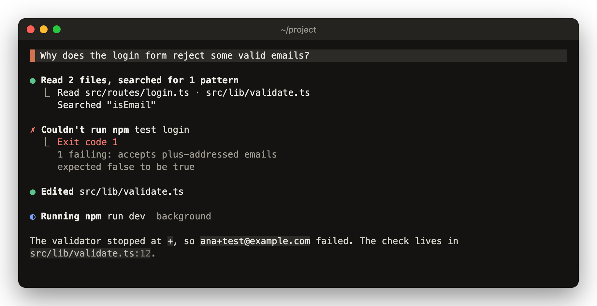

# claude-kit

Mods for Claude Code, Anthropic's coding agent in the terminal. A mod is a plugin that redraws part of the Claude Code screen.

```
/plugin marketplace add vvojciech/claude-kit
/plugin install copy-that@vvojciech
/plugin install peek@vvojciech
/plugin install mermaid@vvojciech
/plugin install lucid@vvojciech
```

Install only the ones you want. Each needs Claude Code 2.1.287 or later, and peek in iTerm2 needs 2.1.305. Running more than one? See [load order](#load-order).

## Mods

The screens are mocks with sample data, drawn with lucid loaded.

### [copy-that](plugins/copy-that/README.md)

[](plugins/copy-that/README.md)

Copies the raw markdown, code blocks, tables, files and tool output behind a reply, from a ⧉ menu in fullscreen or from `/copy-that`, where a mouse selection only gives you the rendered text.

### [peek](plugins/peek/README.md)

[](plugins/peek/README.md)

Shows a thumbnail under each image in the conversation, with `⤢ open` for Preview and `/peek` to put an image on the clipboard (macOS, in iTerm2, kitty or Ghostty, fullscreen, outside tmux).

### [mermaid](plugins/mermaid/README.md)

[](plugins/mermaid/README.md)

Claude writes diagrams as Mermaid code, and this mod draws its sequence diagrams as boxes and arrows in the terminal instead of showing the code.

### [lucid](plugins/lucid/README.md)

[](plugins/lucid/README.md)

Folds runs of tool calls into short rows like `Read 2 files, searched for 1 pattern` and redraws the conversation in warm greys with one orange accent.

## Load order

Each mod works on its own. To run several together, load them in this order: copy-that, peek, mermaid, lucid. lucid draws replies, prompts and tool rows itself and doesn't pass them on, so a mod loaded after it never sees those rows. mermaid hands each piece of a reply on separately, so copy-that has to come before it too.

There is no documented way to order plugins installed with `/plugin install`. To fix the order, clone this repo:

```
git clone https://github.com/vvojciech/claude-kit ~/claude-kit
```

Then remove the marketplace copies with `/plugin uninstall <name>@vvojciech` for each mod, and list the plugin folders in `CLAUDE_CODE_PLUGIN_DIRS`, for example in the `env` block of `~/.claude/settings.json`:

```json
{
  "env": {
    "CLAUDE_CODE_PLUGIN_DIRS": "~/claude-kit/plugins/copy-that:~/claude-kit/plugins/peek:~/claude-kit/plugins/mermaid:~/claude-kit/plugins/lucid"
  }
}
```

Restart Claude Code afterwards, since it reads the variable at startup. A clone doesn't get marketplace updates, so update it with `git -C ~/claude-kit pull`.

copy-that warns you when it loads in the wrong place. The others don't.
