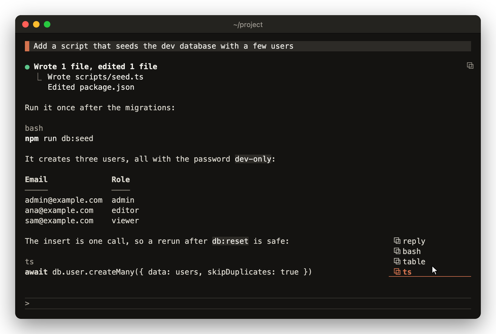

# copy-that

Claude Code renders Claude's markdown in the terminal, so a mouse selection gives you the rendered text: no fences, no `**`, tables redrawn as boxes, link targets gone. copy-that copies the raw text instead. Hover a reply or a tool row and click a chip, or type `/copy-that`.



The screen shows lucid loaded. Hovering the ⧉ under the reply opened the chip list, and the pointer is on `⧉ ts`.

## Install

```
/plugin marketplace add vvojciech/claude-kit
/plugin install copy-that@vvojciech
```

## Requirements

- Claude Code 2.1.287 or later.
- Fullscreen rendering (`/tui fullscreen`) for the ⧉ markers. `/copy-that` works without it.
- A clipboard route: `pbcopy` on macOS, `wl-copy` (from wl-clipboard), `xclip` or `xsel` on Linux, or a terminal that takes OSC 52.

copy-that works alone, with the same list on rows Claude Code draws itself. With lucid or another mod that draws replies, copy-that has to load first. See [load order](../../README.md#load-order) for how to set it.

## Features

### Reply chips

- A muted ⧉ sits on its own row under the end of each finished reply, at the right edge.
- Hover it to open the chips as a list, one per row, right-aligned to the ⧉. Click one to copy.
- The list opens upward over the reply. It opens downward only when the rows above can't hold it, such as on a short reply at the top of the transcript.
- Every row is the same width and the whole row is the target. A margin of 2 cells either side lets the pointer stray a little without closing the list.
- `⧉ reply` copies the whole reply as markdown, including text written before and after tool calls.
- Each code block gets a chip named by its language, such as `⧉ python`. A block with no language is `⧉ code`, a table is `⧉ table`.
- Each blockquote gets `⧉ quote`, which copies what's inside without the `>` markers, so a drafted Slack or PR message pastes as written.
- A GitHub alert (`> [!NOTE]`) is named by its type: `⧉ note`, `⧉ tip`, `⧉ important`, `⧉ warning` or `⧉ caution`. It copies without the `[!NOTE]` line.
- Repeated names are numbered from the top of the reply: `⧉ bash 1`, `⧉ bash 2`, `⧉ quote 1`, `⧉ quote 2`.
- Code blocks copy without their fences. Tables copy as markdown rows.
- Blocks inside quotes, lists and alerts, and indented code, get chips too.
- A reply that was interrupted shows `partial` at the top of its list.
- A reply still being written gets its marker when it ends.
- On a resumed session, when two replies end with the same block, the marker offers that block and a note naming `/copy-that N` for each whole reply.

### Tool chips

- A settled tool row gets a ⧉ beside its first line. Its list opens like a reply's and never covers the row the ⧉ is on.
- `⧉ file` on Write, Edit and Read. Write copies what was written. Edit copies the whole file after the edit. Read copies the text read; images give nothing.
- `⧉ plan` on ExitPlanMode copies the plan.
- `⧉ output` on Bash, Grep, Glob, WebFetch, Agent and MCP tools copies the output with colour codes stripped. Bash gives stdout then stderr, Grep gives matches or file names.
- A folded group of calls gets one chip per call, named by file or tool: `⧉ a.md`, `⧉ bash #1`, `⧉ bash #2`. A group with one copyable call shows `⧉ output` or `⧉ file`, like a single row.
- A background Agent row gets `⧉ output` once its report arrives.
- On a single call the ⧉ itself copies that call. On a group it does nothing, so a click never falls through to expand the row.
- After a copy the ⧉ turns into ✓ or ✗ in place.
- No chip is drawn while a call runs, when it failed or was interrupted, on an expanded live group, or when there is nothing to copy.

### Clipboard

- macOS uses `pbcopy`.
- Linux tries `wl-copy` on Wayland, then `xclip`, then `xsel` on X11.
- Otherwise, and always over SSH, it copies through the terminal with OSC 52. Over SSH it never runs a clipboard tool, so the remote machine's clipboard is never mistaken for yours.
- A chip copy confirms on the clicked row with `copied (pbcopy)` or `copy failed`. Rows are wide enough for that text, so the list doesn't shift.
- An OSC 52 copy also shows a toast saying "paste to check", because the terminal never reports back. Above 100,000 characters it warns that terminals often cut copies that large.
- `/copy-that` answers name what was copied, its line count and the route, such as "Copied python block (4 lines, pbcopy)".
- A failed copy says why, including which Linux tool to install.
- A partial reply copies as such and says "(partial)".

### Narrow panes

- The list needs only its widest row, so it fits a 40-column pane. A name wider than the pane is cut at the edge.
- The list holds as many rows as there are above the ⧉, or half the screen, whichever is more. Chips past that fold into `+N`. Click it for a toast naming them and the `/copy-that` commands for them.
- Toasts wrap to the pane, folding names that don't fit into `+N`.

### Themes

- When lucid is loaded, copy-that takes the tone lucid last drew with, so the marker and chips match it.
- Without lucid, it picks light or dark from the theme name, or from the terminal's `COLORFGBG` under `auto`, and falls back to dark.
- The marker is muted and chips use the text colour. A hovered chip is bold, underlined and orange on the terminal background, at 4.5:1 contrast or better.

## Commands

`/copy-that help` prints the full usage. N counts back from the last, 1 is the last.

| Command | Copies |
| --- | --- |
| `/copy-that` | the last reply as markdown |
| `/copy-that R` | reply R back, so `/copy-that 2` is the reply before the last |
| `/copy-that <name>` | one block by its chip name, such as `/copy-that ruby 2`, or `/copy-that 2 ruby` for an older reply |
| `/copy-that code [N]` | the block with no language. If every block has a language, the Nth code block |
| `/copy-that table` | a table |
| `/copy-that quote [N]` | the Nth quote without its `>` markers, or `/copy-that 2 quote` for an older reply. An alert goes by its type, such as `/copy-that note` |
| `/copy-that file [N]` | the Nth last file Claude wrote, edited or read |
| `/copy-that plan` | the last plan |
| `/copy-that output [N]` | the Nth last Bash, Grep, Glob, WebFetch, Agent or MCP output |
| `/copy-that <call>` | a call by its group chip name, such as `/copy-that notes.md`, `/copy-that bash` or `/copy-that bash #2` |
| `/copy-that selection` | the markdown behind what you last selected with the mouse |

- Names are case-insensitive.
- A chip named by digits, such as `⧉ 123`, needs R first: `/copy-that 1 123`.
- `/copy-that bash 2` is the second bash block in the reply. `/copy-that bash #2` is the second bash call in the latest group that has one.
- `/copy-that selection` widens a partial selection to balanced inline markup and maps rendered lines back to their source. When the selected text appears in more than one place, it copies nothing and asks you to select more.

## No ⧉ under replies

- Fullscreen is off. Turn it on with `/tui fullscreen`.
- Another mod draws replies before copy-that. After the first settled reply copy-that leaves this status line, and every `/copy-that` answer repeats it: `Put copy-that first in CLAUDE_CODE_PLUGIN_DIRS (a plugin listed earlier draws replies)`. See [load order](../../README.md#load-order).
- The reply is still being written. The marker comes when it ends.
- The ⧉ is near the top of the screen and the list is cut off. Scroll down a little.

## OSC 52 copies that never arrive

- iTerm2: turn on "Applications in terminal may access clipboard" in Settings, General, Selection.
- tmux: `set -g set-clipboard on`.
- OSC 52 can't confirm a copy. Paste to check.

## Known limits

- The engine inverts a button under the pointer. copy-that swaps its hover colours to undo that, so a hovered chip sits on the background. On a terminal whose background isn't `#141311` (dark) or `#f5f4f0` (light), a one-row box shows behind the hovered chip.
- Whether the list fits above the ⧉ is judged from the transcript, not the screen, since a mod can't see where its row sits after scrolling.
- While the pointer is on the list, the ⧉ under it isn't drawn. The engine does this.
- The list closes as soon as the pointer leaves its margin. The hover API has no close delay.
- A background agent report that reached the session only as a message copy-that can't read gives no chip, and `/copy-that output` says so.
- A block whose language clashes with a command word (`table`, `code`, `reply`, `quote`, an alert type, `file`, `plan`, `output`, `selection`, `help`) is renamed, for example `⧉ table-code`.
- A quote inside another quote has no chip of its own. A nested quote copies one level shallower.
