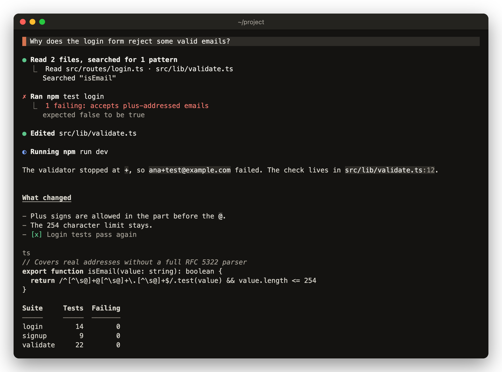

# lucid

By default Claude Code puts a bullet on every reply and a row on every tool call, so a busy turn fills the screen with tool noise. lucid redraws replies, your prompts and tool rows in warm greys with one orange accent, keeps every text colour at WCAG AA contrast, and folds runs of tool calls into short rows that say what happened. Text you select with the mouse pastes as clean prose, and code pastes exactly as written.



## Install

```
/plugin marketplace add vvojciech/claude-kit
/plugin install lucid@vvojciech
```

lucid draws from the moment the install finishes. To get the default look back, uninstall it from the `/plugin` menu.

## Requirements

- Claude Code 2.1.287 or later.
- Optional: peek, to draw local images where they sit in a reply.
- Optional: copy-that, to copy the markdown behind a reply.
- Optional: mermaid, to draw sequence diagrams.

lucid draws replies, prompts and tool rows itself and doesn't pass them on, so copy-that, peek and mermaid have to load before it. See [load order](../../README.md#load-order) for how to set it.

## Features

### Theme and palette

- Follows `/theme` and redraws when you change it.
- A theme name containing "light" or "dark" picks the background, ANSI themes included. Any other theme reads the terminal background from `COLORFGBG`, and falls back to dark.
- Every colour is a fixed hex value, so ANSI themes get the same palette as the rest.
- Warm grey text in four strengths, one orange accent, and separate colours for running, done, failed, added and removed.
- Text colours meet 4.5:1 on the background and on the prompt panel. Rules, bars and the accent meet 3:1.
- Daltonized themes draw added lines in blue and done marks in grey-white, so neither relies on green.

### Markdown

- h1 is bold and underlined with a faint rule under it. h2 is bold and underlined, h3 bold and muted. h1 and h2 get a wider gap above them.
- Lists keep their markdown markers. Ordered lists keep their numbers and delimiter. Tasks show `- [ ]` and `- [x]`, and done items are greyed.
- Tables keep their grid when they fit. Numeric columns align right, and text columns shrink before numbers do. When the columns can't fit, each row stacks as `header: value` lines.
- Code blocks show the language as a muted label with no fences. Keywords are bold, comments muted italic. Diffs colour added and removed lines, and shell blocks colour commands, flags and strings.
- A code line wider than the terminal soft-wraps, with a faint `↪` beside each continuation row.
- Inline code sits on a chip. Inline shell commands are coloured, and file paths are picked out with their `:line` suffix.
- Quotes get one bar per nesting level and quieter text. GitHub alerts (`[!NOTE]`, `[!TIP]`, `[!IMPORTANT]`, `[!WARNING]`, `[!CAUTION]`) get a label.
- Footnote references read `[1]`, and footnote bodies hang past their label.
- `http`, `https`, `mailto` and `file` links become terminal hyperlinks. Other schemes keep just the label, and relative links show the target as a path.
- Leading YAML front matter shows as a `yaml` block. Thematic breaks draw as a short faint rule.
- HTML: `b`, `i`, `u`, `ins`, `del`, `code`, `kbd`, `a`, `q`, `sup`, `sub` and `br` render. `<pre>` becomes a code block, `<details>` and `<summary>` become a `▸` line, images show as `[image: alt]`, and comments are hidden. Other block tags flow as plain text.
- Named and numeric HTML entities are decoded.
- Past the engine's size and nesting limits, the rest of a reply draws as plain text.

### Images

- With peek loaded, a local `` image in a reply draws as a thumbnail where it sits, with the file name, pixel size and a `⤢ open` button beside it.
- An image in the middle of a sentence breaks onto its own row between the words around it.
- Everything else stays `[image: alt]`: web URLs, images inside lists, quotes, tables or headings, and any image when peek isn't loaded, can't find the file, or the terminal can't draw pictures. peek still shows those under the reply.

### Tool rows

- One row per call: a state glyph, a verb and the target, such as `Ran`, `Read`, `Edited`, `Wrote`, `Searched`, `Fetched`, `Watched` or `Loaded skill`.
- Verbs are past tense once a call is done. A call waiting at the permission dialog reads `Wants to run`, `Wants to write` and so on. A failed call reads `Couldn't run`, `Couldn't read` and so on.
- States: pending `◌`, running `◐`, started `○`, done `●`, failed `✗`, and `⊘` for stopped, not allowed or cancelled.
- Stopped means you interrupted a call that had started. Not allowed means the permission check refused it. Cancelled means it never started, or you pressed Esc at its permission dialog.
- Paths show relative to the session directory, home as `~`, link to the file, and cut in the middle so the file name stays.
- A settled group gets a headline in kinds and counts, like `Read 2 files, ran 1 command`. Under it is one line per kind, with the targets joined by ` · `. Bash gets one line per command. Failed or refused calls are named in their own state.
- Background shells, monitors and agents read as running, with a muted `background` note, until their task ends. They read as started when this session never saw the end.
- Task notifications draw as rows with the task's own status and how long it ran.
- MCP tools read `Called server › tool`, with the server name humanised.
- Agent calls read `Delegated to <type>`.
- A new file shows its line count and the first 10 lines. An error shows up to 10 lines, the first in the error colour.

### Prompt panel

- Your prompt sits on a full-width panel with an accent bar on the left.
- Pasted blocks collapse to `[pasted N lines]`. A prompt that is only a paste also shows its first line.

### Mouse selection

- Prose sits flush left with no reply bullet, so it pastes as it would without lucid.
- Headings carry no `#` marker and are followed by a blank line, so they paste as their own paragraph.
- List and task markers are the markdown they came from.
- Code sits in the same column as prose with no bar or gutter in the way, and long lines are left whole for the terminal to wrap. A selection pastes the exact source.
- The inline code chip is a background colour, so it never ends up in the paste.

For the markdown source, use copy-that.

### While a reply streams

- Inline markers such as `**` or a backtick show as written until they close, then the span restyles. Claude Code's own renderer does the same.
- The last line or two can wait a moment while they could still turn into a table, a fence or a list.
- Widths are measured in terminal cells, so emoji and wide characters count as two.

## Commands

None. lucid starts drawing as soon as it loads, and follows `/theme` from then on.

## Known limits

- Rows that are still running, and rows you expand with ctrl+o, are drawn by Claude Code's own renderer, so elapsed time, progress and full output stay.
- The `N background agents launched` row is Claude Code's own. A mod can't reach it.
- A bare URL long enough to wrap is clickable on its first row only.
- A light terminal drawn dark: pick a theme with "light" in its name in `/theme`, or set `COLORFGBG`.
- Each streamed token re-parses the block still being written. That takes a few milliseconds at normal sizes, and 50 to 125ms per token for a single block near 100KB.

## For mod authors

lucid adds `$.lucid` to the engine. Types live in `types/index.d.ts`.

- `blocks({ text, requestId })` returns the block outline of a reply as lucid parses it: kind, source, depth, start and end offsets in the original text, and the language and body of code blocks. Pass the `requestId` of a reply that is still streaming to get the streaming parse.
- `tone()` returns the background (`dark` or `light`), whether the theme is daltonized, and a frozen copy of the palette as `#rrggbb` values. It is `undefined` until lucid has drawn once.
- Reply images go through peek's `$.peek.picture`, which does the reading, converting and sizing.
- lucid leaves the grouped Agent launch row, live and expanded rows (`isRunning`, `isActive`, `isExpanded`), and groups that went well but hold more than calls (`isCallsOnly` false) to the engine.
- The Stopped, Not allowed and Cancelled marks live in session state, so a reload keeps them. lucid doesn't rely on PostToolUseFailure, since another plugin can answer it first.
- During streaming a held line is one of: an unfinished fence info line, a table delimiter row, a setext underline, a bare list or quote marker, a `[label]` that may become a definition, or a partial `</pre>`. At most two lines are held. A finished reply skips this.
- Inline HTML is a tag only when every bare attribute is a real HTML boolean, so `i<a and j>0 ... </a>` stays prose while `<details open>` works.
