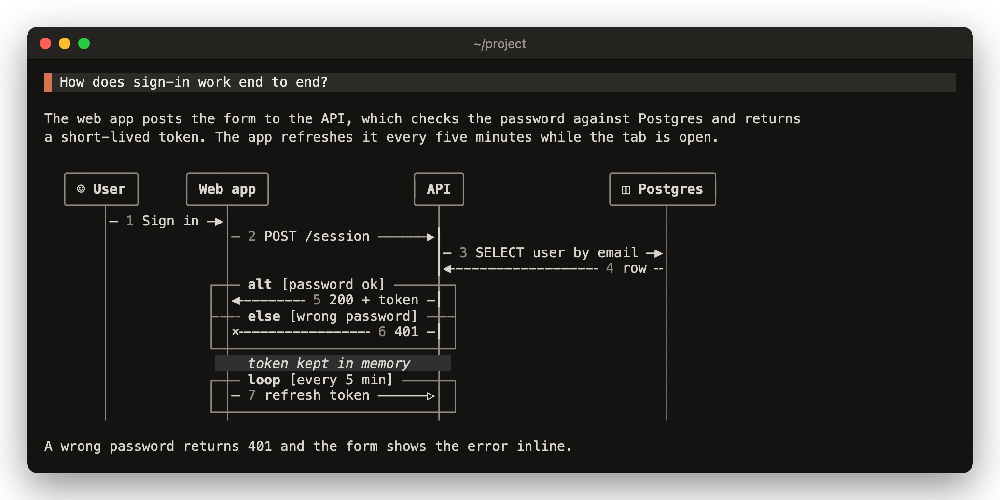

# mermaid

Claude sometimes answers with a diagram written in Mermaid, a text format for diagrams. Claude Code shows that as a code block you have to picture in your head. This mod draws each Mermaid `sequenceDiagram` and `flowchart` as boxes and arrows in its place, between the prose around it. Anything it can't draw stays as source, with a short note saying why.



Drawn with lucid loaded. The mod also works alone, and then Claude Code draws the rest of the reply.

## Install

```
/plugin marketplace add vvojciech/claude-kit
/plugin install mermaid@vvojciech
```

## Requirements

- Claude Code 2.1.287 or later.
- Only if you also use lucid: load the mermaid mod before it. lucid draws the reply itself, so a mod loaded after it never sees the text, and nothing warns you.
- Only if you also use copy-that: load copy-that before the mermaid mod, since the mod hands each piece of a reply on separately.

See [load order](../../README.md#load-order) for how to set the order.

## Features

### Drawing

- Participants sit in boxes of equal height above centred lifelines. Actors get a `☺` mark.
- Each participant that sends a message gets its own colour, and its box, lifeline and arrows use it.
- Arrow heads: `▶` filled, `▷` async, `×` cross, `⇀` half, none for open. Dashed messages draw dashed, and the stroke of a dashed return is dimmed.
- Each label sits above its arrow, starting at the sender's end, and the arrow runs the whole way from sender to receiver. It cuts straight through lifelines it passes.
- Self messages draw as `↺` and the label beside the lifeline. A long label wraps under itself.
- Activation bars thicken the lifeline, and nested activations are offset.
- `loop`, `alt` and the other blocks are framed around the lanes they use, with the condition in brackets on the top edge. Nested frames are inset. `rect` is shaded instead of framed.
- Notes sit in a box, in italics.
- `MERMAID_STYLE=plain` turns off the colours and the dimmed returns, and puts notes on a tinted background instead of a box. The tint is darker on a dark theme.
- Box groups get a label row above their participants and a rail down each side.
- Autonumbers are dimmed and sit beside their label.
- A created participant starts at its `create` row, and a destroyed one ends in a box.

### Flowcharts

- `flowchart` and `graph`, in `TD`, `TB`, `BT`, `LR` and `RL`.
- Nodes are laid out in ranks. Long edges run straight and short detours bend round them.
- Shapes: `[box]`, `(rounded)`, `([stadium])`, `((circle))`, `{decision}` with slanted corners and `◇` tips, `{{hexagon}}` with `<` `>` tips, `[(database)]` with doubled ends, `[[subroutine]]` with doubled sides, and `>flag]`.
- Edges `-->`, `---`, `-.->` (dimmed and dashed), `==>` (heavy), `<-->` and `~~~` (invisible), with `|label|` or `-- label -->` text, chains and `&`.
- Edges of one stroke into a box meet on a bus over one arrowhead, and each stroke leaves through its own port. Left to right, extra strokes and arrows use a box's top and bottom.
- Branches keep the order the source declares them. An edge that closes a cycle loops round the outside of the chart on a lane of its own, on the side its source sits.
- `subgraph` blocks are framed with their title in the border, and an edge crossing a frame shows a `┼`.
- `classDef`, `class`, `style`, `click` and `linkStyle` lines are read and skipped.

### Syntax

- `sequenceDiagram` in a closed ```` ```mermaid ```` or `~~~mermaid` fence. Fences inside lists and blockquotes are found too.
- `participant` and `actor`, with `as` aliases, quoted names and `@{ type, alias }` metadata in JSON or YAML form.
- Participant types `queue`, `database`, `entity`, `boundary`, `control` and `collections`, each marked by a glyph before the name.
- `create` and `destroy`.
- `box` groups with a label. Any colour on the box line is dropped.
- Every message arrow: `->`, `-->`, `->>`, `-->>`, `-x`, `--x`, `-)`, `--)`, `<<->>`, `<<-->>`, and the v11 half arrows, reversed ones included.
- `activate`, `deactivate`, and the `+` and `-` shorthand on arrows.
- `Note left of`, `right of` and `over` one or two participants.
- `loop`, `alt`/`else`, `opt`, `par`/`and`, `par_over`, `critical`/`option`, `break` and `rect`.
- `autonumber` with a start, a step, and `off`.
- `title`, and a title in YAML front matter.
- `;` between statements, `%%` comments, `<br/>` line breaks, and `#35;` or `#quot;` style entities.
- Keywords in any case.
- `wrap:` and `nowrap:` prefixes, `accTitle` and `accDescr` are accepted but not drawn.

### Width

- Every row fits the terminal width.
- Spare width goes where it saves the most wrapped label rows.
- Labels wrap at word breaks first, then at `/`, `,`, `→`, `(`, `_` and `::` inside identifiers. Participant names may also fold at a CamelCase hump, up to four lines.
- A detail line or trailing `(...)` that doesn't fit in a participant's box moves to a numbered legend under the diagram.
- When a name or label still can't fit, it is cut and the full text goes in a numbered footnote under the diagram. A note with no room leaves a marker and moves to the footnotes.
- Wide characters and emoji count as two cells.
- The diagram becomes a list with one line per message, such as `Customer → Shop  submit order`, when not every participant fits with its name whole.
- It also becomes a list when more than a quarter of the messages would end up in footnotes.
- In the list, `⇢` marks dashed and `↺` self messages, frames draw as `┌ ├ └` and notes sit behind `┆`.

### Fallbacks

- A fence still streaming shows as a plain code block until it closes, so a half-written diagram never flashes.
- Other diagram types stay as source with `mermaid: pie not drawn yet, sequenceDiagram and flowchart only` under them.
- A flowchart too wide for the terminal, even with its labels wrapped, stays as source with the width it needs.
- An empty fence says there is no diagram type.
- A diagram mermaid.live would reject (unknown lines, an unclosed block, an extra `end`, a `deactivate` while inactive) stays as source with each problem and its line number listed under it.
- Problems mermaid.live accepts, such as `links` lines or a `()` central connection, are listed under the drawn diagram.
- One bad diagram doesn't stop the others in the same reply from drawing. If drawing throws, the reply falls back to source with the reason.

## Commands

None. A diagram draws as soon as its `mermaid` fence closes.

## A diagram shows as a code block

- lucid loads before the mermaid mod. Check that `CLAUDE_CODE_PLUGIN_DIRS` lists mermaid before lucid. See [load order](../../README.md#load-order).
- The fence never closed. The mod draws only once the closing fence arrives.
- The diagram isn't a `sequenceDiagram`. A note under the block says so.
- mermaid.live would reject it. The problems are listed under the block.

## Known limits

- A flowchart node that links to itself is listed under the chart instead of drawn. Nested subgraphs share one frame margin.

- `link`, `links`, `properties` and `details` lines are not drawn.
- Box and `rect` colours are dropped. `rect` uses one fixed shade.
- With `MERMAID_STYLE=plain`, the note tint picks light only when the theme name contains "light", and it is read once per session, so a `/theme` change shows after a restart.
- A diagram inside a list splits it: the list restarts after the diagram.
- Only the terminal draws diagrams. Summary rows and other surfaces, such as the desktop app, show the source.
