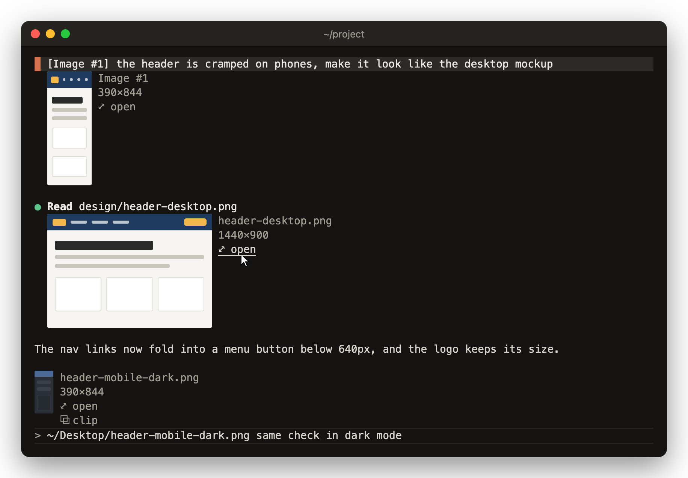

# peek

Claude Code shows an image as a line of text: `[Image #1]`, `Read image (412KB)`, or the alt text of a markdown link. peek draws a small thumbnail of the picture under that row, with a `⤢ open` button that opens the original in Preview. `/peek` puts an image on the clipboard so ctrl+v attaches it to your next prompt. macOS only, in iTerm2, kitty or Ghostty, outside tmux.



Drawn with lucid loaded. The small picture just above the prompt line is the band for the draft you're typing, not part of the conversation.

## Install

```
/plugin marketplace add vvojciech/claude-kit
/plugin install peek@vvojciech
```

## Requirements

- macOS. Conversion, `⤢ open` and `/peek` use `sips`, `open` and the macOS clipboard. peek doesn't check the platform, so elsewhere it loads but those fail.
- iTerm2, kitty or Ghostty. Terminal.app can't draw pictures.
- In iTerm2, Claude Code 2.1.305 or later. kitty and Ghostty draw on any version peek runs on.
- Not inside tmux or screen. Claude Code can't pass pictures through them yet.
- Fullscreen rendering (`/tui fullscreen`).

Where pictures can't draw, peek shows one line per image instead, `▣ shot.png  ⤢ open`, and the button still works.

With lucid loaded, peek has to load before it. See [load order](../../README.md#load-order).

## Features

### Thumbnails

- Images pasted into a prompt, under the prompt row. peek reads them from Claude Code's per-session image cache.
- Images Claude reads, writes or edits (`.png .jpg .jpeg .gif .webp .heic`), under the tool row, or under a folded group of rows once it settles.
- Image files a Bash command names, such as `sips ... --out chart.png`, if the file exists afterwards.
- Local `` images in Claude's replies, absolute, `~/` or relative to the working directory.
- Each thumbnail keeps the image's aspect ratio, is at most 8 rows tall and 48 columns wide, and shows the file name and pixel size beside it.
- Thumbnails under a row stack in a column, up to 4 per transcript row.
- Large or non-PNG images are shrunk to a PNG with `sips` and cached.
- `⤢ open` opens the original file in Preview, or in its default app if Preview refuses. If both fail you get a toast with the reason.

peek adds to the rows other mods draw rather than replacing them, so copy-that's ⧉ chips keep working. With lucid loaded, a reply image lucid already draws in place isn't repeated under the reply.

### Band above the prompt

- While you type, a strip just above the prompt shows the images in the draft.
- It shows each `[Image #N]` you pasted, and any bare image path, such as one iTerm2 pastes when you drag a file in.
- Band thumbnails are at most 3 rows tall and sit side by side.
- A bare path gets a `⧉ clip` button that puts it on the clipboard, so ctrl+v turns it into a real attachment.

## Commands

A mod can't attach image bytes to a prompt, so peek puts the image on the macOS clipboard and you press ctrl+v:

- `/peek <path>` takes a file, absolute, `~/` or relative. Quotes and backslash escapes such as `\ ` are fine.
- `/peek last` takes the newest screenshot or PNG in your screenshot folder (the one macOS saves screenshots to), ~/Desktop or ~/Downloads.
- `/peek clipboard-check` says whether the clipboard already holds an image.
- `/peek` on its own, or `/peek help`, prints the usage.

The image goes on the clipboard as PNG and a toast says `Image on clipboard: press ctrl+v`. This replaces whatever was on the clipboard.

## Lines instead of pictures

Thumbnails fall back to `▣ name  ⤢ open` lines when:

- you're inside tmux or screen;
- fullscreen is off (turn it on with `/tui fullscreen`);
- the terminal isn't iTerm2, kitty or Ghostty;
- you run kitty with a `TERM` that doesn't contain "kitty";
- you're in iTerm2 on Claude Code before 2.1.305;
- Claude Code refused to draw the first picture of the session. peek then turns pictures off and writes `peek: pictures off, ...` to the debug log.

`CLAUDE_CODE_FORCE_TERMINAL_IMAGES=1` makes peek try pictures in any terminal outside tmux and screen, such as one that speaks the kitty protocol under another name.

## Known limits

- The picture itself can't be clicked. Use the `⤢ open` button beside it.
- A pasted image shows only while Claude Code's session image cache still holds it. A resumed session whose cache was cleared shows nothing for it.
- iTerm2 sends picture bytes in-band, so a transcript full of large images redraws slower. Thumbnails are kept small for that reason.
- Web images in replies are skipped. Fetching whatever a reply links to would let a reply make your machine call out.

## For mod authors

peek adds `$.peek` to the engine. Types live in `types/index.d.ts`.

- `picture({ path, cwd, columns, isFullscreen, requestId })` draws a local image the way peek's thumbnails do, with the same conversion, cache and capability check.
- `path` may be absolute, `~/`, `file://` or relative to `cwd` (the session's directory by default). Pass `requestId` so the capability check can test the picture you drew.
- `picture` returns one of:
  - `{ source: { png }, columns, rows, alt, path, name, caption, open, key }`. Draw the `Image` under `key`.
  - `{ fallback: 'pictures-off' }` when pictures can't draw.
  - `{ fallback: 'unresolved' }` when the file is missing or not an image.
- `open({ path, cwd })` opens the original in Preview and returns `{}`, or `{ error }` after a toast with the reason.
- If a mod draws an image under a key from `$.peek.picture`, peek doesn't draw it again under the reply.
- Non-PNG files, and PNGs over 512 KiB, are converted with `/usr/bin/sips` to an 800 px PNG in `/tmp/claude-<uid>/peek` (`~/Library/Caches/peek` if that folder isn't private to you), stepping down to 512 and 256 px if the result is still over 2 MiB. Conversions are cached by path and modification time; a failed one is tried again after 30 seconds. `/peek` converts a non-PNG at full size and deletes the copy once it's on the clipboard.
